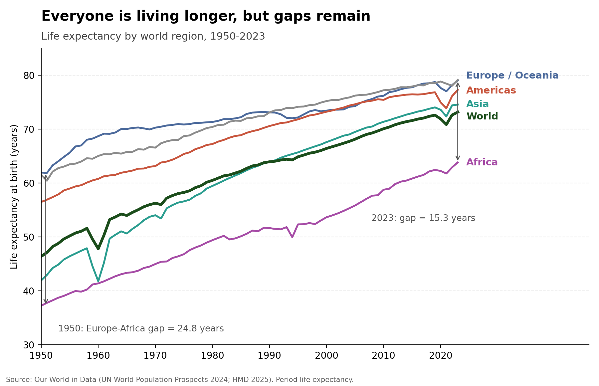
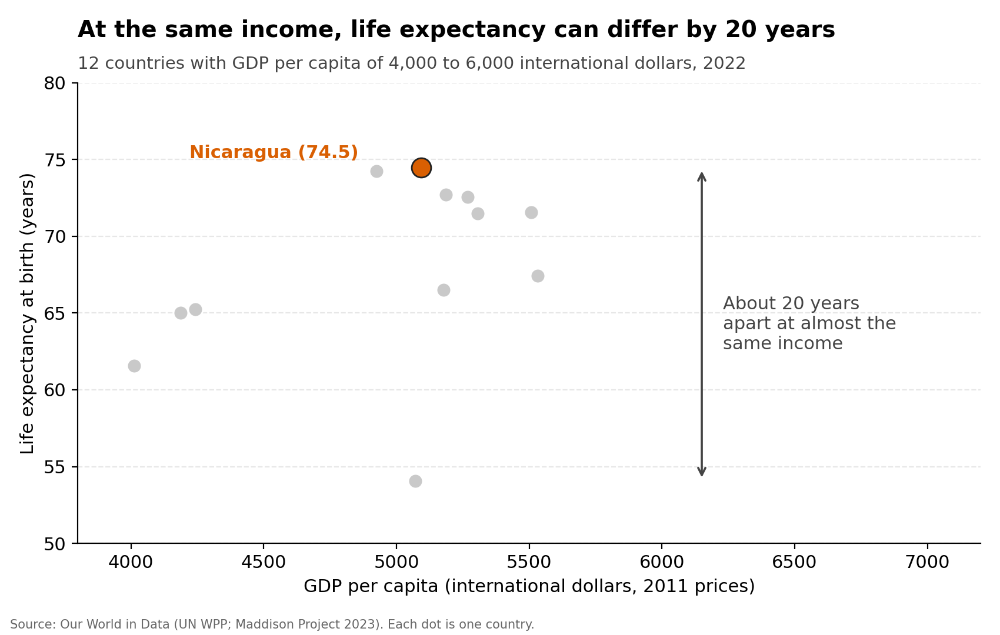
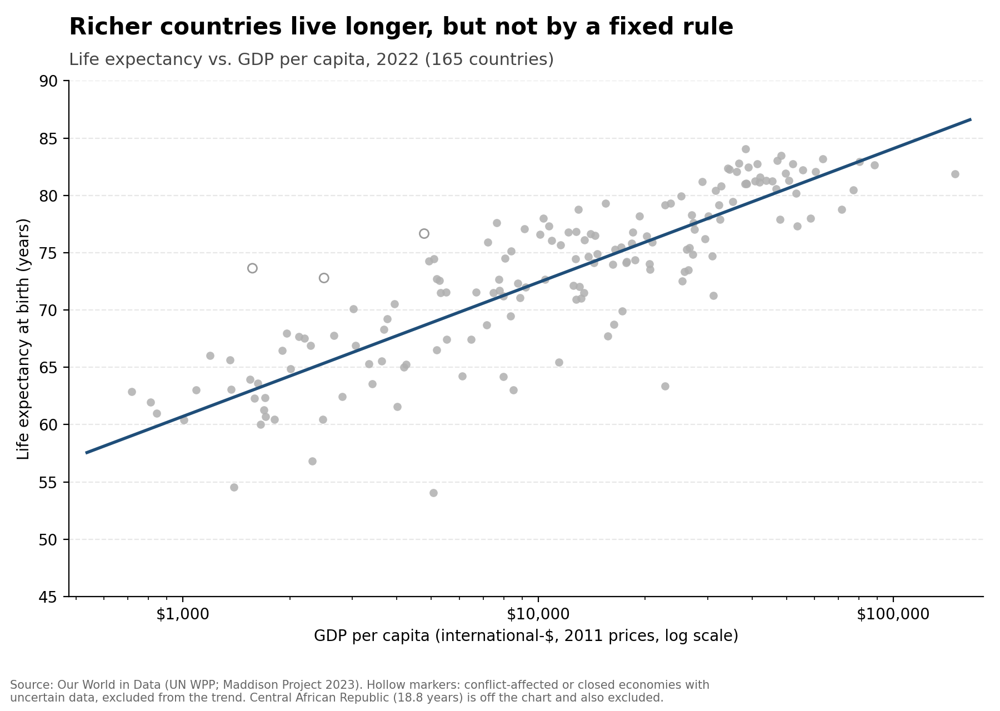
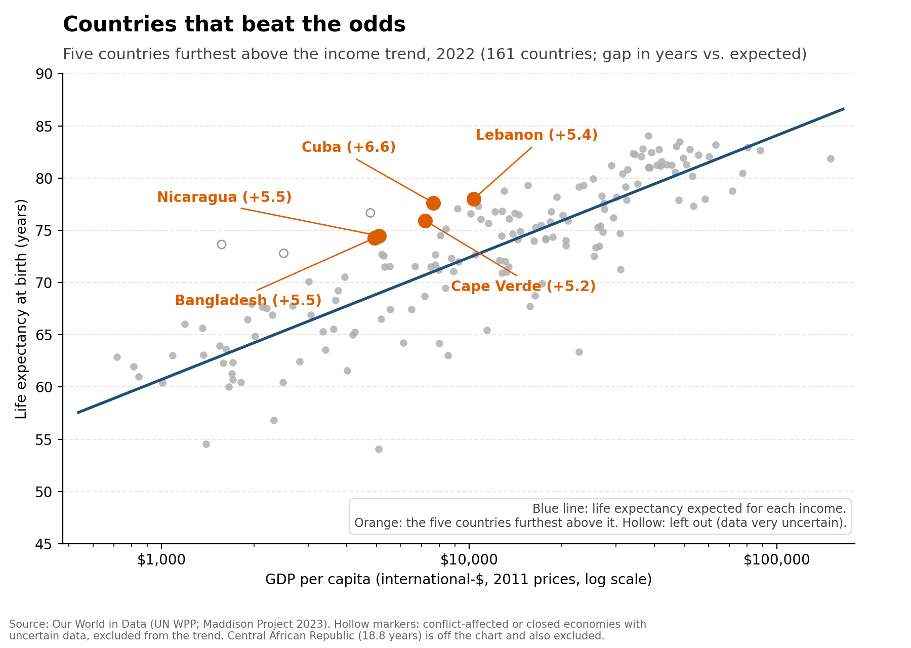
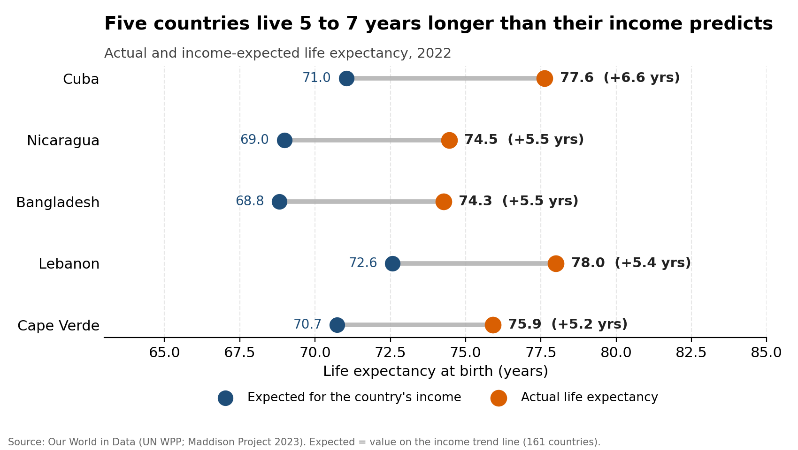
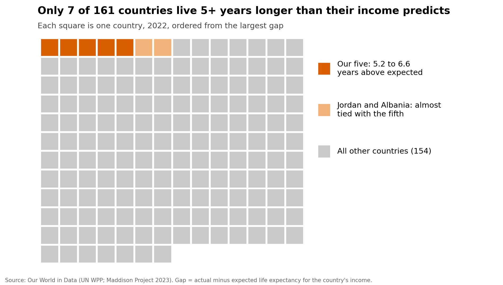
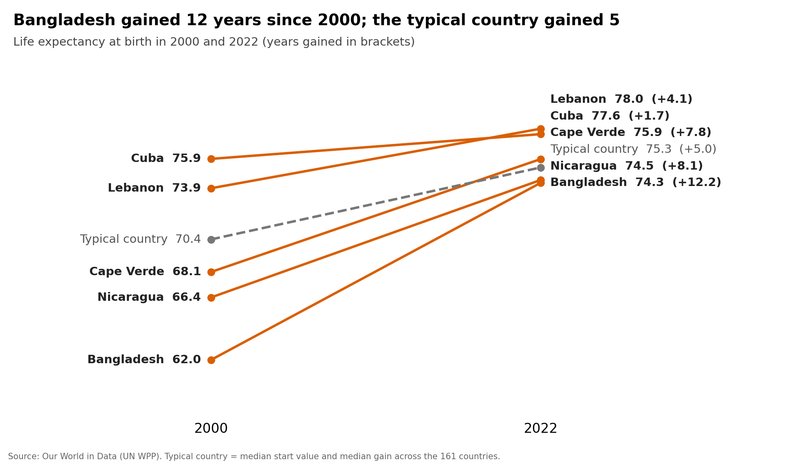
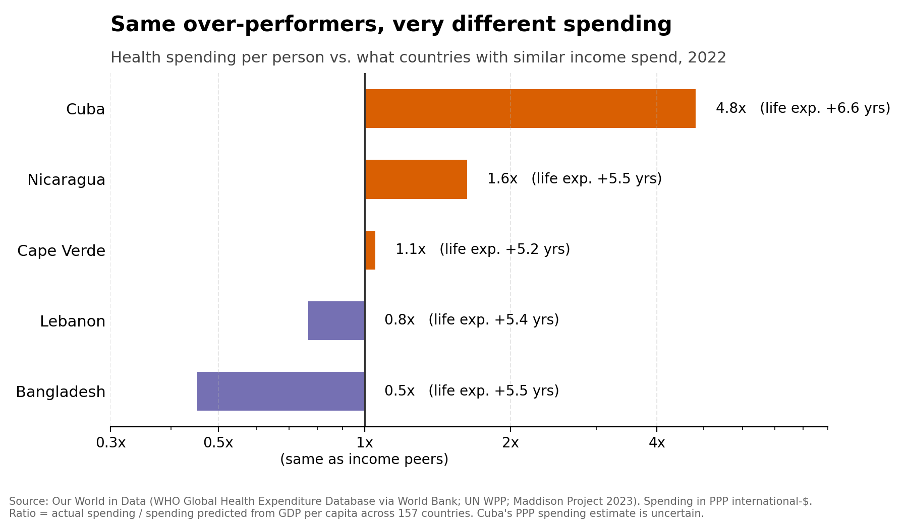
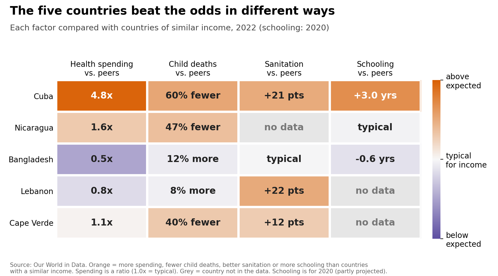

<!--
Slide titles follow our storyboard (see STORYBOARD.md). Images are drafts from index.qmd and the
scripts in this repo; save them in a figures/ folder next to this file. Titles are final-ish, visuals are drafts.
-->

## Everyone lives longer, but gaps remain

{fig-align="center" width="75%"}

::: {.notes}
Card 1, setting. Life expectancy has risen in every region since 1950. The Europe-Africa gap fell from about 25 years to 15, but it is still large.
:::

## At the same income, life expectancy can differ by 20 years

{fig-align="center" width="70%"}

::: {.notes}
Card 2, hook. 12 countries have incomes around 4,000 to 6,000 dollars, yet life expectancy ranges from 54 to 74 years. Nicaragua is at the top. Money matters, but it does not settle how long people live. Why do some countries live longer than their income suggests?
:::

## Income explains about three quarters of the differences

{fig-align="center" width="70%"}

::: {.notes}
Card 3. Each dot is one of 161 countries in 2022. The blue line is the life expectancy expected for each income: a straight-line trend of life expectancy against income on a log scale. The gap is actual minus expected.
:::

## But five countries beat the odds

{fig-align="center" width="62%"}

{fig-align="center" width="62%"}

::: {.notes}
Card 4, Aha moment. Cuba, Nicaragua, Bangladesh, Lebanon and Cape Verde live roughly 5 to 7 years longer than their income predicts, despite very different healthcare spending. Hollow dots are four countries left out because their data is highly uncertain. Show the dumbbell if there is time: blue is expected, orange is actual.
:::

## That is rare: only 7 of 161 countries

{fig-align="center" width="75%"}

::: {.notes}
Card 5. Each square is one country. Our five have the largest gaps, but Jordan and Albania are almost tied with the fifth, so the five are examples. Optional: the world map (figures/visual_map_gap.png) shows they are scattered across the world.
:::

## They improved at very different speeds

{fig-align="center" width="80%"}

::: {.notes}
Card 6. Since 2000 the typical country gained about 5 years. Bangladesh gained 12. Cuba started high and gained only 1.7.
:::

## Healthcare spending is not a single explanation

{fig-align="center" width="70%"}

::: {.notes}
Card 7. Spending relative to countries with similar incomes. Cuba spends about 4.8 times as much, Bangladesh about half. Cuba's spending estimate is uncertain.
:::

## Child survival and sanitation offer clues, but no single route

{fig-align="center" width="75%"}

::: {.notes}
Card 8. Child survival and sanitation fit some of the five, but no single factor explains all of them. Bangladesh is not explained by any factor we tested. Grey cells are missing data.
:::

## Inequality and schooling add little

- Income inequality (Gini): a very weak link to the gap, and recent data for only two of the five
- Years of schooling: a weak link; the 2020 values are partly projected

::: {.notes}
Card 9, a short slide. An honest "does not explain much" result is still a finding. Optional: figures/visual5_gini_vs_gap.png.
:::

## Income matters, but the story is more complex

- Wealth matters, but it does not decide how long people live
- The exceptions are starting points for questions, not proof of what works
- These are associations, not causes; one year of data; some estimates are uncertain
- Next: look closer at individual countries and at the factors we could not test

::: {.notes}
Card 10, conclusion and next steps. Invite questions.
:::
