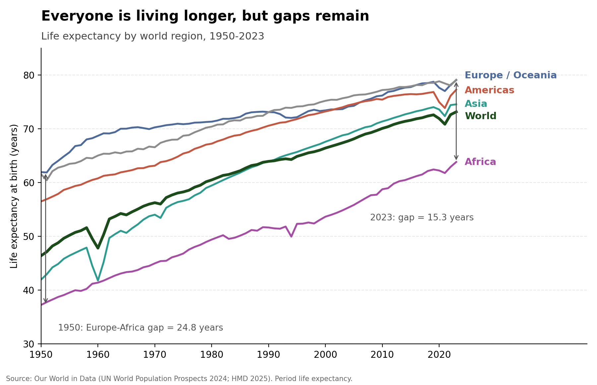
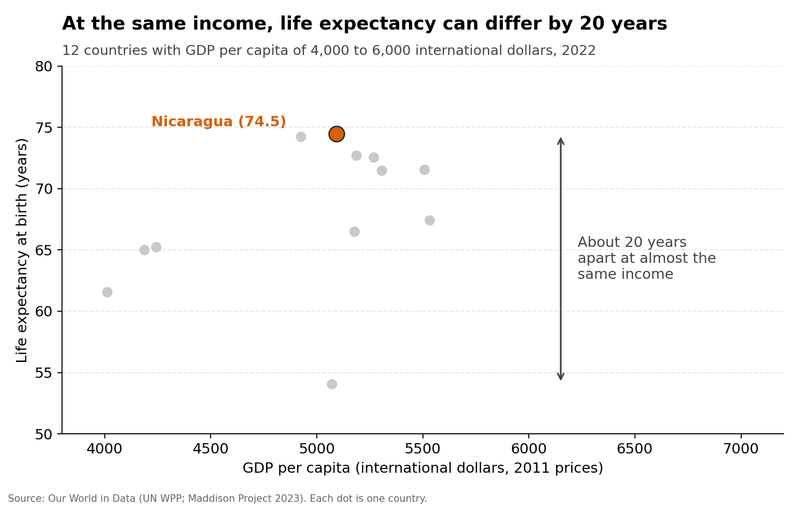
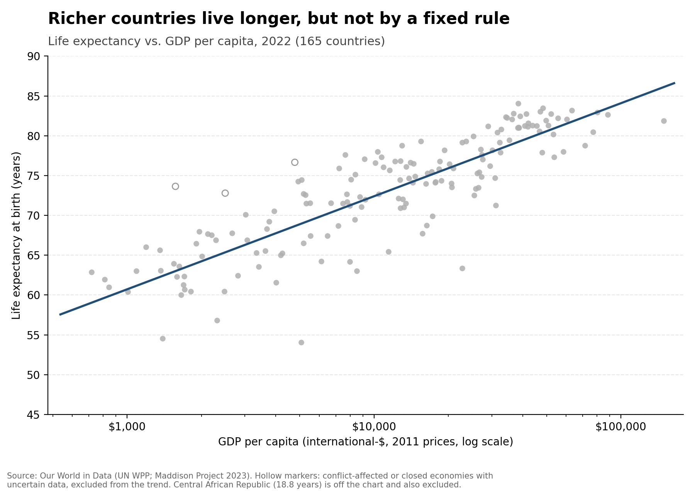
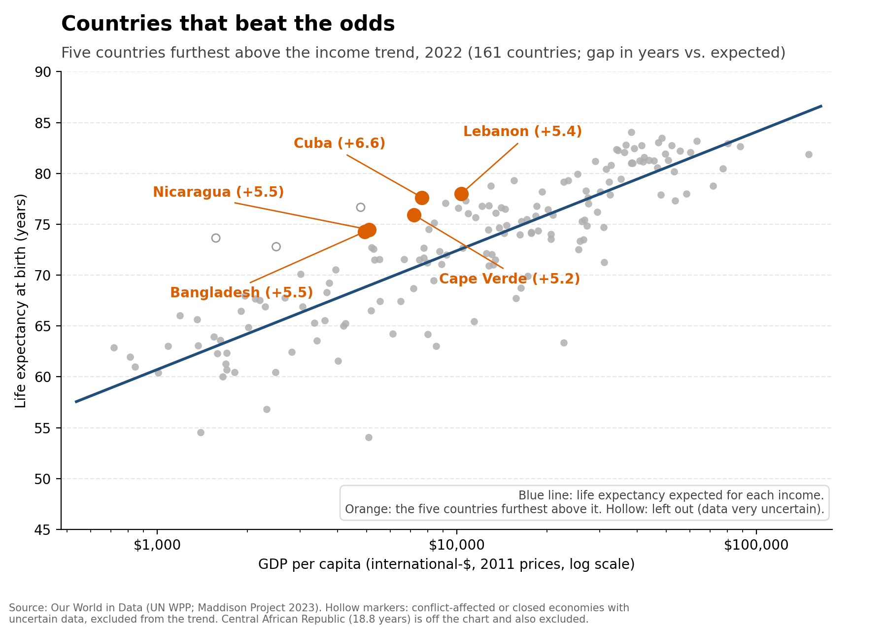
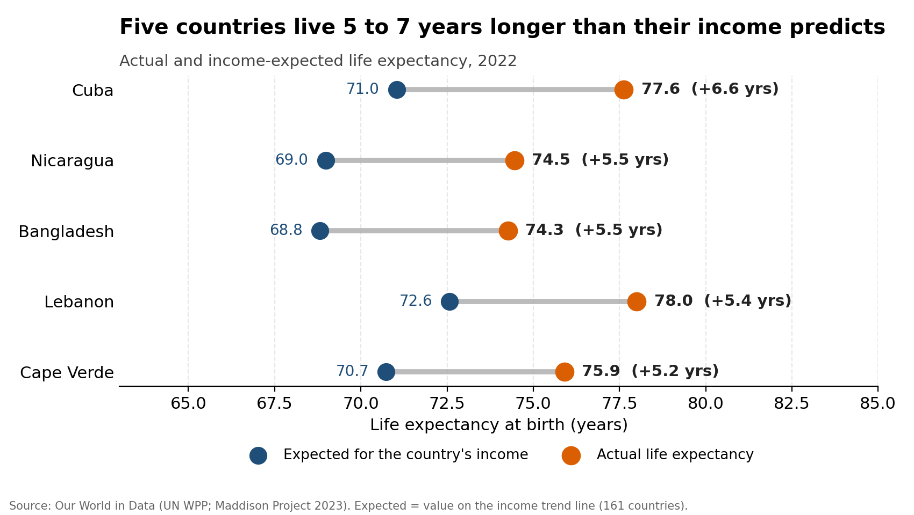
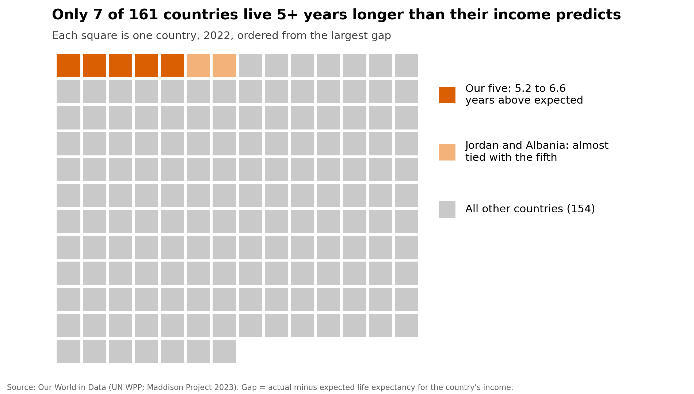
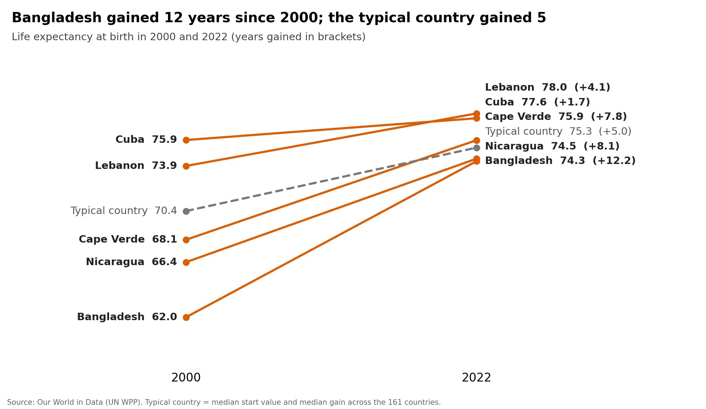
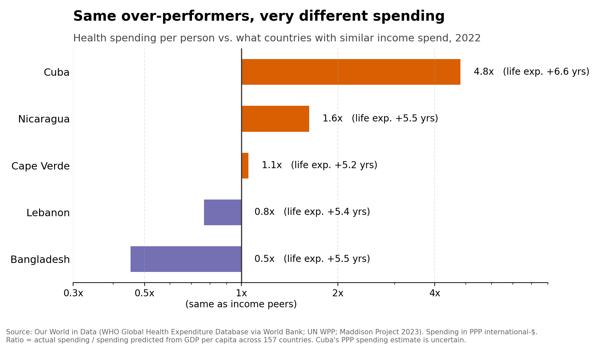
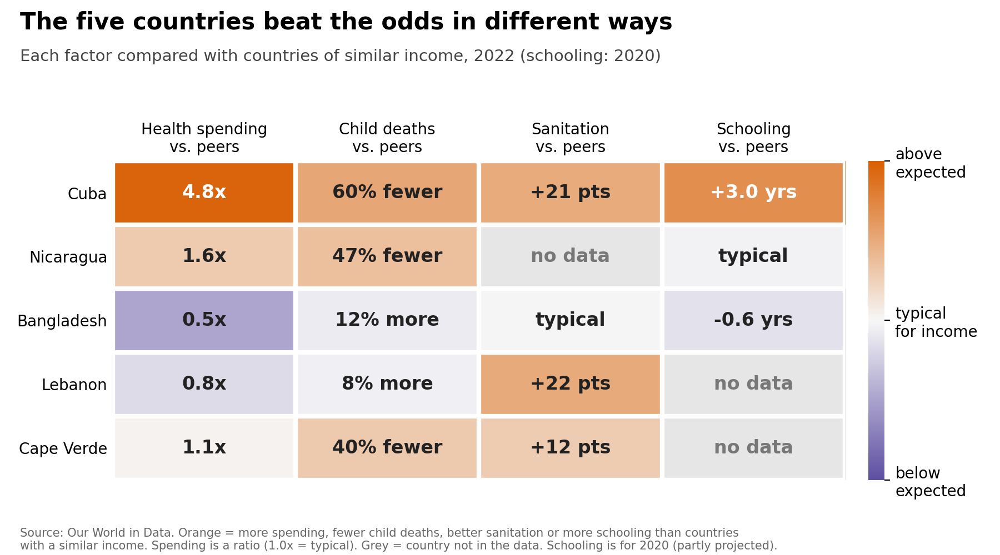

## Everyone lives longer, but gaps remain

{fig-align="center" width="62%"}

*Life expectancy is rising everywhere, but not equally. What explains the gaps?*

::: {.footer}
Source: Our World in Data (UN WPP), 1950 to 2023
:::

::: {.notes}
Opening: our question is not whether income matters, but why some countries live longer than their income would predict. We compare countries to find exceptions and explore possible explanations, without claiming causation. Card 1, setting. Life expectancy has risen in every region since 1950. The Europe-Africa gap fell from about 25 years to 15, but it is still large.
:::

## At the same income, life expectancy can differ by 20 years

{fig-align="center" width="70%"}

*So income is not the whole story. How much does it explain?*

::: {.footer}
Source: Our World in Data (UN WPP; Maddison Project 2023), 2022
:::

::: {.notes}
Card 2, hook. 12 countries have incomes around 4,000 to 6,000 dollars, yet life expectancy ranges from 54 to 74 years. Nicaragua is at the top. Money matters, but it does not settle how long people live. Why do some countries live longer than their income suggests?
:::

## Income accounts for much of the variation

{fig-align="center" width="70%"}

*Most countries follow the trend. A few sit far above it.*

::: {.footer}
Source: Our World in Data (UN WPP; Maddison Project 2023), 2022
:::

::: {.notes}
Card 3. Each dot is one of 161 countries in 2022. The blue line is the life expectancy expected for each income: a straight-line trend of life expectancy against income on a log scale. The gap is actual minus expected.
:::

## Five countries live longer than income predicts

{fig-align="center" width="72%"}

*Cuba, Nicaragua, Bangladesh, Lebanon and Cape Verde stand out. How large are their gaps?*

::: {.footer}
Source: Our World in Data (UN WPP; Maddison Project 2023), 2022
:::

::: {.notes}
Card 4, Aha moment. Cuba, Nicaragua, Bangladesh, Lebanon and Cape Verde live roughly 5 to 7 years longer than their income predicts. Explain that the gap is observed minus model-predicted life expectancy. Some uncertain country estimates were excluded from the ranking. Next, compare observed and predicted values directly.
:::

## The gap is observed minus predicted life expectancy

{fig-align="center" width="76%"}

*The difference between the observed and model-predicted values defines “beating the odds.”*

::: {.footer}
Source: Our World in Data (UN WPP; Maddison Project 2023), 2022
:::

::: {.notes}
Explain how to read the two endpoints for each country. These are differences relative to a statistical trend, not evidence that income causes a particular life expectancy. Transition: how uncommon are such large positive gaps?
:::

## Large positive gaps are uncommon

{fig-align="center" width="75%"}

*Did these countries always do well, or did they catch up?*

::: {.footer}
Source: Our World in Data (UN WPP; Maddison Project 2023), 2022
:::

::: {.notes}
Card 5. Each square is one country. Our five have the largest gaps, but Jordan and Albania are almost tied with the fifth, so the five are examples. Optional: the world map (figures/visual_map_gap.png) shows they are scattered across the world.
:::

## The five countries followed different trajectories

{fig-align="center" width="80%"}

*Is healthcare spending the reason?*

::: {.footer}
Source: Our World in Data (UN WPP), 2000 to 2022
:::

::: {.notes}
Card 6. Since 2000 the typical country gained about 5 years. Bangladesh gained 12. Cuba started high and gained only 1.7.
:::

## Healthcare spending alone cannot explain the pattern

{fig-align="center" width="70%"}

*If not spending alone, what else could help?*

::: {.footer}
Source: Our World in Data (WHO via World Bank; Maddison Project 2023), 2022
:::

::: {.notes}
Card 7. Spending relative to countries with similar incomes. Cuba spends about 4.8 times as much, Bangladesh about half. Cuba's spending estimate is uncertain.
:::

## Child survival and sanitation offer partial clues

{fig-align="center" width="75%"}

*What about inequality and schooling?*

::: {.footer}
Source: Our World in Data (UN IGME; WHO/UNICEF JMP; World Bank), latest year available
:::

::: {.notes}
Card 8. Child survival and sanitation fit some of the five, but no single factor explains all of them. Bangladesh is not explained by any factor we tested. Grey cells are missing data.
:::

## Inequality and schooling show weak associations

- Income inequality (Gini): a very weak link to the gap, and recent data for only two of the five
- Years of schooling: a weak link; the 2020 values are partly projected

*So what is the overall picture?*

::: {.footer}
Source: Our World in Data (World Bank PIP; Barro and Lee)
:::

::: {.notes}
Card 9, a short slide. An honest "does not explain much" result is still a finding. Optional: figures/visual5_gini_vs_gap.png.
:::

## Income matters, but it is not destiny

- Wealth matters, but it does not decide how long people live
- The exceptions are starting points for questions, not proof of what works
- These are associations, not causes; one year of data; some estimates are uncertain
- Next: look closer at individual countries and at the factors we could not test

::: {.notes}
Card 10, conclusion and next steps. Invite questions.
:::

## Sources and interpretation notes

- Our World in Data: life expectancy (UN World Population Prospects), GDP per capita (Maddison Project 2023)
- Our World in Data: health spending (WHO / World Bank), child mortality (UN IGME), sanitation (WHO/UNICEF JMP)
- Our World in Data: inequality (World Bank PIP), schooling (Barro and Lee)
- Main cross-sectional comparison: 2022; other indicators use their stated years or latest available values
- The fitted income trend and observed–predicted gaps describe **associations, not causal effects**

::: {.notes}
Check exact indicator links, retrieval dates, model specification, and sample sizes against the HTML report before final submission.
:::
